<div align="center">

# 🅿️ Smart Parking Lot Allocation and Billing System

**A MySQL database with a Python desktop application for live slot allocation, reservations, gate entry and exit, duration billing, passes, payments and reports.**


<br>

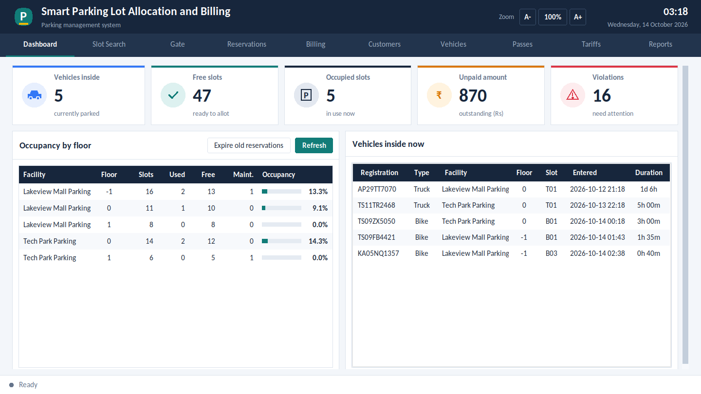

</div>

---

## 📑 Table of Contents

1. [About the Project](#-about-the-project)
2. [Key Features](#-key-features)
3. [Screenshots](#-screenshots)
4. [Tech Stack](#-tech-stack)
5. [Database Design](#-database-design)
6. [Business Rules](#-business-rules)
7. [Project Structure](#-project-structure)
8. [Getting Started](#-getting-started)
9. [Using the Application](#-using-the-application)
10. [Testing](#-testing)
11. [Presentations, Report and Video](#-presentations-report-and-video)
12. [Troubleshooting](#-troubleshooting)
13. [Future Scope](#-future-scope)
14. [Author](#-author)

---

## 📌 About the Project

Parking buildings that issue paper tickets suffer from two problems: **two vehicles are sent to the same slot**, and **some stays are never billed**. Reports such as occupancy and peak hours are also almost impossible to produce.

This project replaces manual tickets with a relational database that:

- allocates free slots **live**, matching the slot to the vehicle type;
- records **every entry and exit** with timestamps;
- handles **reservations** and **monthly, quarterly and annual passes**;
- **bills automatically** from the duration and the tariff;
- produces **management reports** (occupancy, peak hours, violations, revenue).

The important business rules are enforced **inside MySQL**, so no program or user can break them.

> **Course project:** Design and Implementation of a Database Management System for Smart Parking Lot Allocation and Billing System (Review 1, Review 2 and Review 3).

---

## ✨ Key Features

| Area | What you can do |
|---|---|
| 🔍 **Slot search** | Find free slots by facility and vehicle type; close or reopen a slot for maintenance |
| 🚪 **Gate** | Allow entry with **automatic slot allocation**; exit and generate the bill in one step |
| 📅 **Reservations** | Book a slot for a time window, cancel it, and expire unused bookings |
| 💳 **Billing and payments** | Full or part payment (cash, card, UPI, wallet) with live balance |
| 🎫 **Passes** | Sell, renew and delete monthly, quarterly and annual passes |
| 👥 **Customers and vehicles** | Add, update, delete and search with validation |
| 💰 **Tariffs** | Hourly rate and daily cap per facility and vehicle type, with effective dates |
| 📊 **Reports** | 10 reports with charts and **CSV export** |
| 🔎 **Zoom and clarity** | 80% to 200% zoom, sharp text on high-DPI screens |
| 🛡️ **Safety** | Two-layer validation, friendly error messages, transactions with rollback |

---

## 📸 Screenshots

<table>
  <tr>
    <td align="center"><br><b>Dashboard</b></td>
    <td align="center">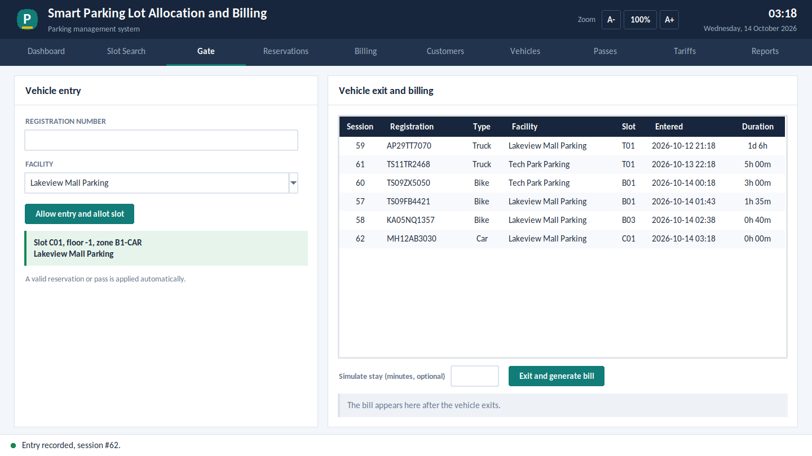<br><b>Gate: entry and slot allocation</b></td>
  </tr>
  <tr>
    <td align="center">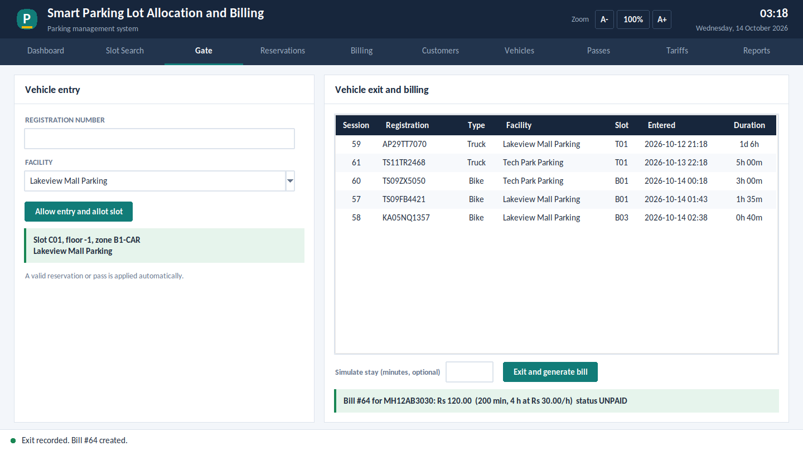<br><b>Gate: exit and bill</b></td>
    <td align="center">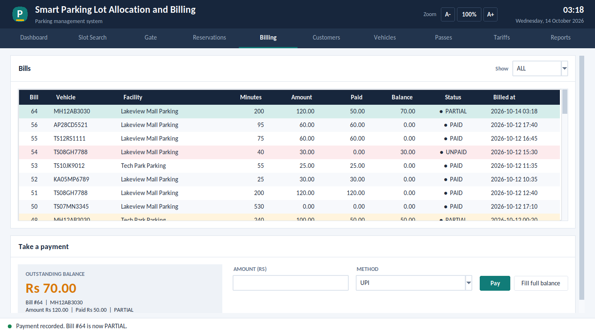<br><b>Billing and part payment</b></td>
  </tr>
  <tr>
    <td align="center">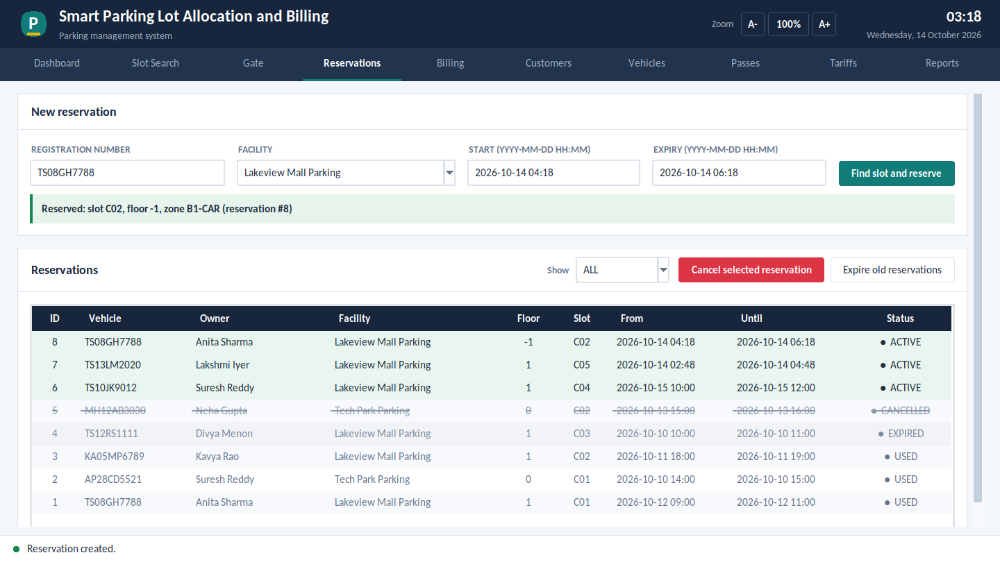<br><b>Reservations</b></td>
    <td align="center">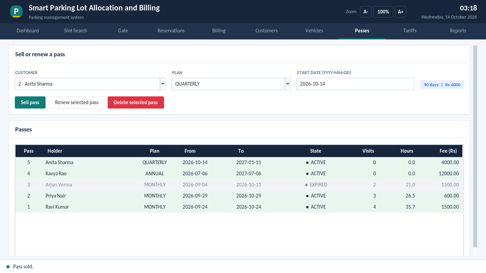<br><b>Passes</b></td>
  </tr>
  <tr>
    <td align="center">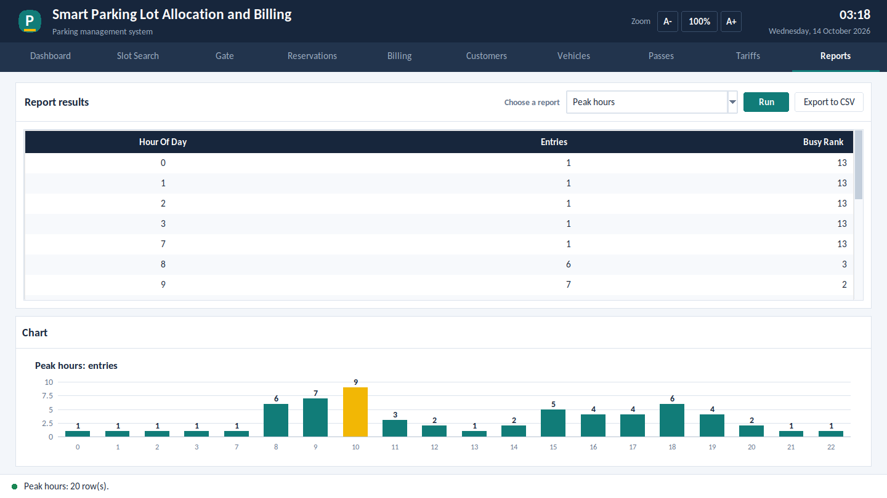<br><b>Report: peak hours</b></td>
    <td align="center">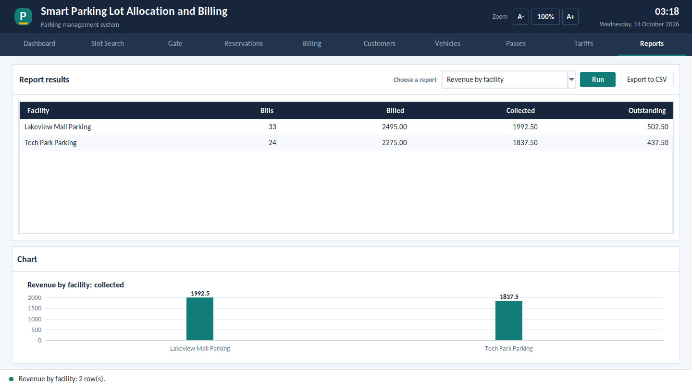<br><b>Report: revenue</b></td>
  </tr>
  <tr>
    <td align="center">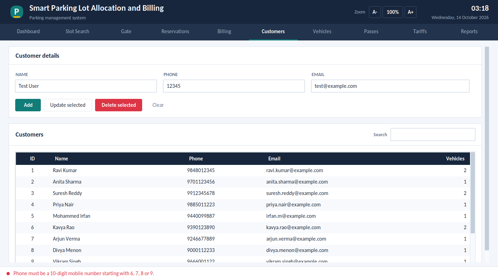<br><b>Validation: invalid phone</b></td>
    <td align="center"><br><b>Dashboard at 150% zoom</b></td>
  </tr>
</table>

<details>
<summary>More screens</summary>

| | |
|---|---|
| 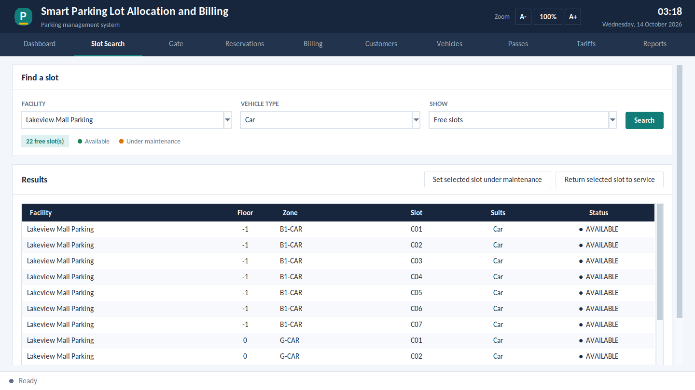 | 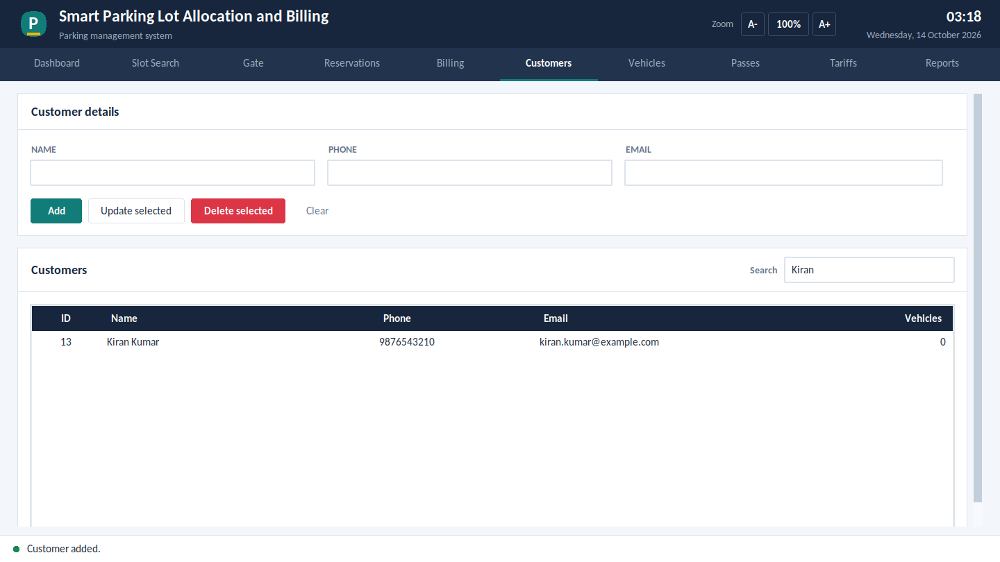 |
| 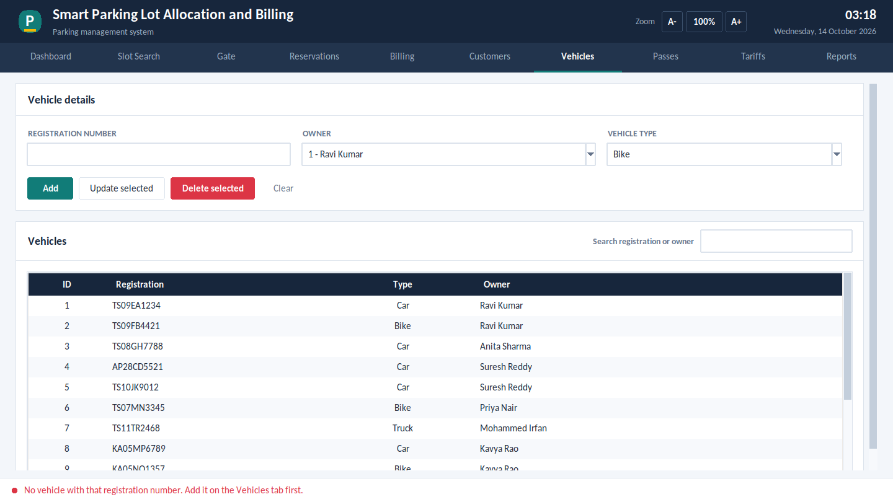 | 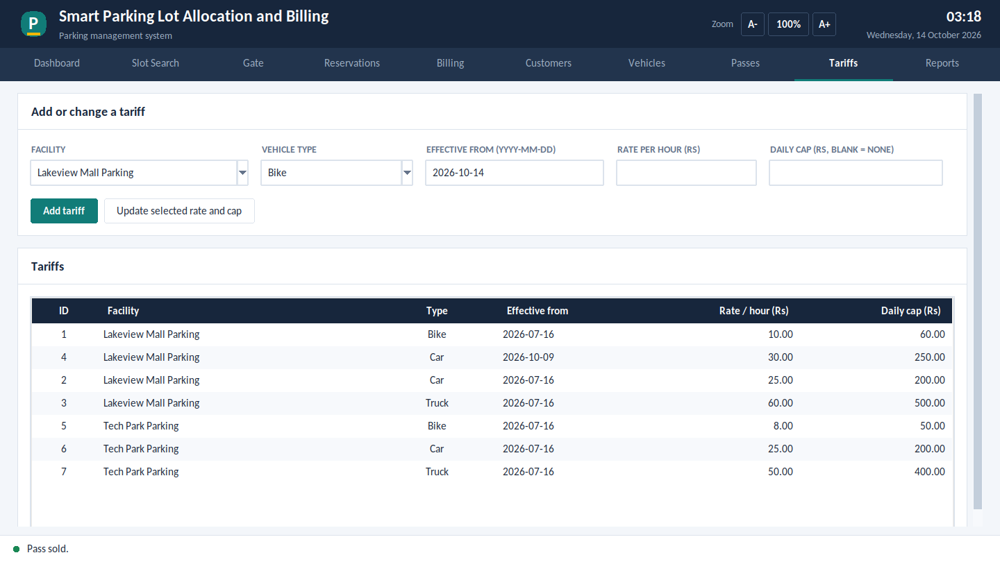 |
| 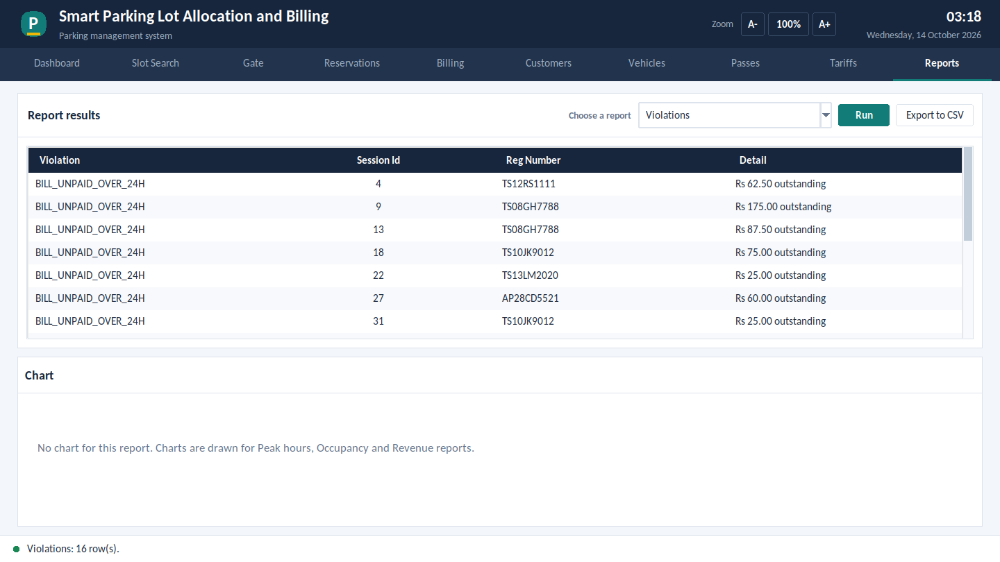 | 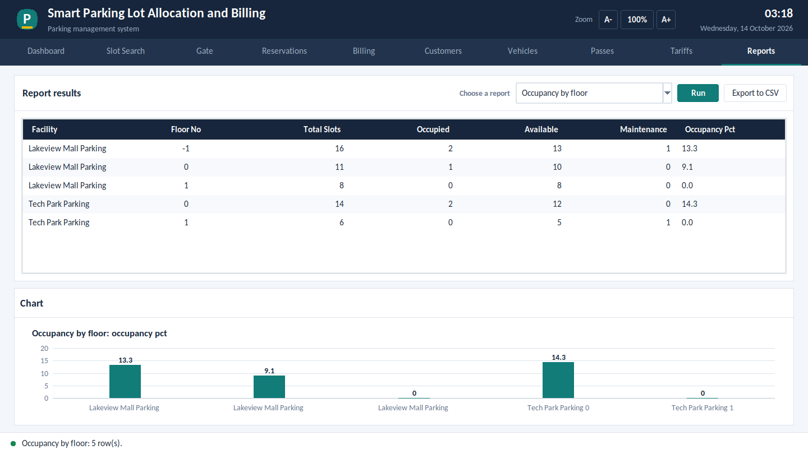 |

</details>

---

## 🧰 Tech Stack

| Layer | Technology |
|---|---|
| Database | **MySQL 8.0** (tables, CHECK and UNIQUE constraints, triggers, functions, stored procedures, views) |
| Application | **Python 3** with **Tkinter** (no extra GUI library) |
| Connector | `mysql-connector-python` |
| Testing | `unittest` and the MySQL command-line client |
| Version control | Git and GitHub |

**Application layers**

```
Screen        gui.py, widgets.py, theme.py      10 pages, one design system, zoom
Logic         services.py, validators.py,       operations, input checks,
              errors.py, reports.py             friendly error messages
Database      db.py  ->  MySQL                  parameterised queries, rules in the database
```

All queries use placeholders, so user input never becomes part of the SQL text (no SQL injection).

---

## 🗄️ Database Design

**13 tables, normalized to Third Normal Form (3NF).**

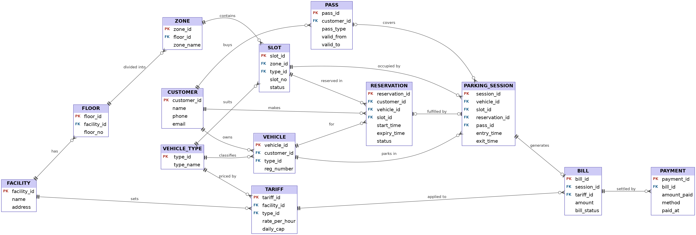

| Group | Tables |
|---|---|
| Structure | `facility`, `floor`, `zone`, `slot`, `vehicle_type` |
| People | `customer`, `vehicle` |
| Bookings | `reservation`, `pass` |
| Operations | `parking_session` |
| Money | `tariff`, `bill`, `payment` |

| Database object | Count |
|---|---|
| Tables | 13 |
| Foreign keys | 18 |
| Triggers | 8 |
| Functions | 2 (`fn_pick_tariff`, `fn_bill_amount`) |
| Stored procedures | 5 (`sp_allocate_slot`, `sp_vehicle_entry`, `sp_vehicle_exit`, `sp_make_payment`, `sp_expire_reservations`) |
| Views | 9 (occupancy, free slots, duration, peak hours, pass usage, violations, bill details, daily revenue, slot location) |

Full 3NF argument, functional dependencies and the data dictionary: [`docs/normalization_and_data_dictionary.md`](docs/normalization_and_data_dictionary.md)

### Billing method

- Time is rounded **up** to whole hours, with a **minimum of one hour**.
- Each full 24 hours costs the **daily cap**; the remaining hours cost *hours × rate*, never more than the cap.
- A vehicle with a **valid pass** pays Rs 0 for the stay.
- The amount is calculated by the database, so it **cannot be typed in by hand**.

---

## 🔒 Business Rules

All rules are enforced inside MySQL.

| Rule | How it is enforced |
|---|---|
| One active vehicle per slot | Overlap trigger plus a UNIQUE index on a generated column |
| Slot and vehicle type must match | Entry and reservation triggers |
| Exit must be after entry | CHECK constraint plus update trigger |
| Reservations expire | Entry trigger and `sp_expire_reservations()` |
| Charges follow the tariff | `fn_bill_amount()` run by the bill trigger |
| Exit and bill succeed together | `sp_vehicle_exit` runs in one **transaction** with rollback |
| No overpayment | Payment trigger |

---

## 📁 Project Structure

```
DBMS_PBL/
├── main.py                    start the application
├── requirements.txt           Python dependency
├── README.md                  this file
├── app/
│   ├── config.py              database settings, pass plans, payment methods
│   ├── db.py                  MySQL connection wrapper
│   ├── errors.py              MySQL errors turned into plain sentences
│   ├── validators.py          input checks
│   ├── services.py            all operations (search, gate, billing, CRUD, passes, tariffs)
│   ├── reports.py             report queries and chart definitions
│   ├── theme.py               design system: colours, fonts, spacing, zoom
│   ├── widgets.py             themed buttons, panels, tables, cards, charts
│   ├── settings.py            remembers the zoom level
│   └── gui.py                 the screen (10 pages)
├── sql/                       00 user · 01 schema · 02 data · 03 views · 04 queries · 05 rule tests · 06 SQL demo
├── tests/                     23 automated tests
├── tools/                     reset_db.py · demo_run.py · make_screenshots.py
├── docs/                      data dictionary, user guide, test cases, viva questions, report
├── screenshots/               output screens of the running application
└── presentations/             Review 2 and Review 3 slides
```

---

## 🚀 Getting Started

### Requirements

- **MySQL 8.0.16 or newer** (earlier versions do not enforce CHECK constraints)
- **Python 3.9 or newer** with Tkinter (included with Python on Windows and macOS; on Ubuntu run `sudo apt install python3-tk`)

### Installation (Windows Command Prompt)

**1. Get the project**

```
git clone https://github.com/YOUR-USERNAME/DBMS_PBL.git
cd DBMS_PBL
```

**2. Create the database, rules and sample data** (type your MySQL root password when asked)

```
mysql -u root -p < sql\00_create_app_user.sql
mysql -u root -p < sql\01_schema.sql
mysql -u root -p smart_parking < sql\02_sample_data.sql
mysql -u root -p smart_parking < sql\03_views.sql
```

> Run these in order. `01_schema.sql` deletes and recreates the `smart_parking` database, so re-running steps 2 to 4 resets everything to fresh sample data.

**3. Install the Python connector**

```
python -m pip install -r requirements.txt
```

**4. Start the application**

```
python main.py
```

### Database login used by the app

| Setting | Default | Environment variable |
|---|---|---|
| Host | `127.0.0.1` | `PARKING_DB_HOST` |
| Port | `3306` | `PARKING_DB_PORT` |
| User | `parking_app` | `PARKING_DB_USER` |
| Password | `parking123` (demo user created by step 2) | `PARKING_DB_PASSWORD` |
| Database | `smart_parking` | `PARKING_DB_NAME` |

---

## 🖥️ Using the Application

| Page | What you do there |
|---|---|
| **Dashboard** | Vehicles inside, free and occupied slots, unpaid money, violations, occupancy by floor |
| **Slot Search** | Free slots by facility and type; close or reopen a slot |
| **Gate** | Enter a registration number to allot a slot; select a vehicle and exit to create its bill |
| **Reservations** | Book, cancel, expire |
| **Billing** | Choose a bill, take a full or part payment |
| **Customers / Vehicles** | Add, update, delete, search |
| **Passes** | Sell, renew, delete |
| **Tariffs** | Add a price from a date, or change one |
| **Reports** | Ten reports, charts, export to CSV |

**Zoom:** click **A+ / A-** in the header, press **Ctrl +** and **Ctrl -**, or hold **Ctrl** and use the mouse wheel. **Ctrl 0** resets to 100%.

Try these to see the rules at work:

- Enter vehicle `MH12AB3030`, then exit it with a simulated stay of `200` minutes. The bill is **Rs 120.00**.
- Add a customer with phone `12345`. It is refused with a clear message.
- Delete customer 1. It is refused because they still own vehicles.

Full guide: [`docs/user_guide.md`](docs/user_guide.md)

---

## 🧪 Testing

```
python -m unittest discover -s tests -v
```

| Test set | Count | Covers |
|---|---|---|
| Automated tests (Python and MySQL) | **23** | Billing rules, gate, payments, CRUD, passes, tariffs, all reports, transaction rollback, error wording |
| Database rule tests (`sql/05_constraint_tests.sql`) | **20** | Invalid data refused by the database |
| Screen workflow checks | **58** | Every workflow at 100%, 150% and 200% zoom |

Details: [`docs/test_cases.md`](docs/test_cases.md) · Raw output: [`docs/test_results.txt`](docs/test_results.txt)

Other tools:

```
python tools\demo_run.py                                      # scripted walk-through in the console
python tools\reset_db.py                                      # rebuild the database
mysql -u root -p -f smart_parking < sql\05_constraint_tests.sql   # 20 statements that must be refused
```

---

## 🎓 Presentations, Report and Video

| Item | Link |
|---|---|
| Review 2 slides | [`presentations/Smart_Parking_DBMS_Review2.pptx`](presentations/Smart_Parking_DBMS_Review2.pptx) |
| Review 3 slides | [`presentations/Smart_Parking_DBMS_Review3.pptx`](presentations/Smart_Parking_DBMS_Review3.pptx) |
| Project report | [`docs/Project_Report.pdf`](docs/Project_Report.pdf) |
| Viva preparation | [`docs/viva_questions.md`](docs/viva_questions.md) |
| Demo video | 🎥 [Watch on YouTube / Drive](https://your-video-link-here) |

---

## 🛠️ Troubleshooting

| Problem | Fix |
|---|---|
| "Cannot connect to the database" | Start MySQL (Windows: Services, **MySQL80**, Start) and check that step 2 was completed |
| `No module named tkinter` | Install Tkinter (Ubuntu: `sudo apt install python3-tk`; Windows: re-run the Python installer, Modify, tick *tcl/tk*) |
| `No module named mysql` | Run `python -m pip install -r requirements.txt` |
| Errors mentioning CHECK or syntax while loading `01_schema.sql` | MySQL is older than 8.0.16, or it is MariaDB. Use MySQL 8 |
| "Access denied for user 'root'" | Wrong MySQL password. Type it again carefully |
| Text looks small | Press **A+**, or **Ctrl +**, to zoom in |

---

## 🔭 Future Scope

- Number plate recognition at the gate
- Online and QR payments
- Web or mobile front end
- User logins with roles (customer, operator, administrator)
- Dynamic pricing for peak hours

---

## 👤 Author

**[D.SNIGDHA CHOUDARY]**


---

<div align="center">

*Built as an academic DBMS project.*

</div>
